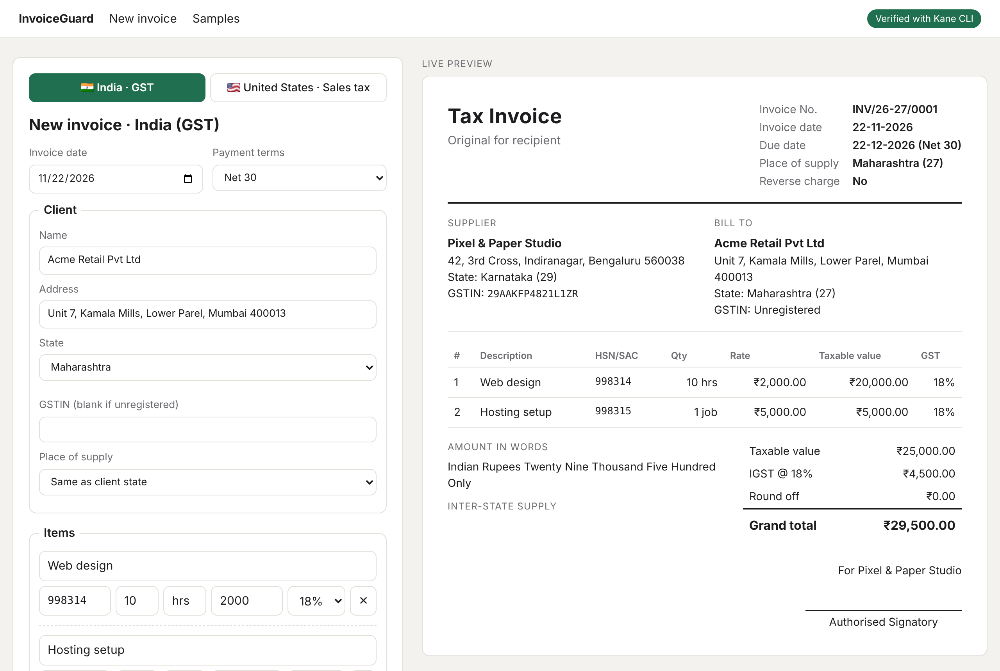
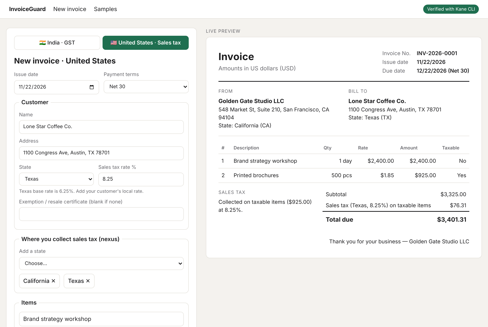
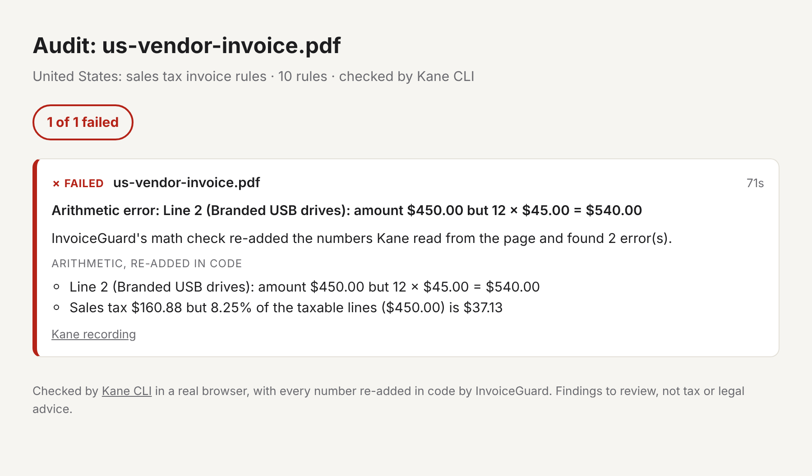

# InvoiceGuard

**Your AI coding agent can't say "done" until a real browser says the invoice is right.**

Tax rules written in plain English, checked by [Kane CLI](https://github.com/LambdaTest/kane-cli) in Chrome,
with the bug report going straight back to Claude Code, which fixes it. India GST and US sales tax built in,
contracts too.

- 🧾 **Rules anyone can read and edit:** `kane/rules/*.md`. Add your country in a pull request.
- 🛑 **A Stop hook for Claude Code:** Kane blocks the agent with the bug, the evidence and a fix until it's right.
- ➗ **Kane reads, code does the math:** and the reader graduates to free, offline Playwright.

**Try it in 15 seconds, no account:** `npm install && npx playwright install chromium && npm run demo`


<sub>Excerpt from a real session, shown as a terminal: full transcript in
[docs/evidence/closed-loop.md](docs/evidence/closed-loop.md).</sub>

**Live app:** https://invoiceguard-n45divs-projects.vercel.app · **Kane caught 5/5 planted bugs, unit tests 2/5**
([proof](docs/evidence/prove.md)) · **every check recorded** ([recordings](docs/evidence/recordings.md))

> Built for the [KaneCLI Hackathon](https://www.kaneclihack.sh/) · agent: Claude Code · verifier: Kane CLI

| India · GST | United States · sales tax |
| --- | --- |
|  |  |

## Why

Invoice tax mistakes cost real money, and they're the kind of bug a refactor slips in quietly and a unit
test never sees. Kane catches them because it reads the invoice the way your client does.

**India.** The most common mistake is charging **CGST + SGST on a sale that crosses state lines and
should be IGST**. The buyer can't claim input tax credit, the invoice has to be re-issued, and the seller
can end up paying the tax twice.

**United States.** Sales tax is set per state, collected only where you have **nexus**, and often doesn't
apply to services. The usual mistakes:

- taxing the whole invoice instead of only the taxable items,
- charging a reseller who handed you an exemption certificate,
- collecting in a state where you have no nexus,
- charging tax in Oregon, Montana, New Hampshire, Delaware or Alaska.

Over-collecting annoys customers. Under-collecting becomes your own liability at audit time.

## What's in the box

| Piece | What it does |
| --- | --- |
| **Invoice app** (`app/`, `lib/gst.ts`, `lib/us.ts`) | Next.js editor with a live preview and an India / US switch. **India:** IGST vs CGST/SGST/UTGST, GSTIN checksum + state-code validation, HSN/SAC, round-off, amount in words (lakh/crore), financial-year numbering. **US:** nexus states, per-line taxable flag, exemption certificates, no-sales-tax states, state base rates as a starting point. |
| **Rulebooks** (`kane/rules/`) | `india-gst.md`: 13 rules based on the mandatory contents of a tax invoice ([CGST Rules, rule 46](https://cbic-gst.gov.in/)). `us-sales-tax.md`: 10 rules for nexus, taxability, exemptions and math. Plain English, editable by anyone. Add a rulebook for your own country. |
| **User flows** (`kane/flows/*.md`) | Plain-English journeys through the editor, e.g. "bill a Mumbai client and expect IGST 18%" or "tax only the taxable line for a Texas customer". |
| **`invoiceguard gate`** | Kane opens every sample invoice and flow in an isolated headless Chrome (in parallel) and checks them. |
| **`invoiceguard hook`** | Claude Code **Stop hook**. If the app changed, Kane re-verifies; failures come back to Claude as a block with Kane's bug title, root cause, evidence and suggested fix. |
| **`invoiceguard audit <url\|file>`** | Audit *any* invoice you receive, from a link, an HTML or Markdown file, or a PDF. It works out whether the invoice is Indian or American and uses the matching rulebook. |
| **MCP server** (`mcp/server.mjs`) | Any MCP agent (Claude Code, Claude Desktop, Cursor, Windsurf, Codex) can call `check_document`, `check_invoice_against_contract`, `list_rulebooks` and `verify_project`. Kane's verdict comes straight back to the agent. |
| **Contract rulebooks** (`kane/rules/services-contract.md`, `invoice-vs-contract.md`) | 12 checks for missing or contradictory terms in a services agreement (fee in words vs figures, payment terms, termination, IP, governing law, signatures). 5 checks that an invoice bills what the contract says (client, rates, terms, dates, currency). |
| **CI** (`.github/workflows/invoiceguard.yml`) | The same gate on every push and PR. |

## Kane reads, code does the math

Kane is excellent at **reading** an invoice and unreliable at **arithmetic**. In testing it passed
"each amount equals quantity × rate" on a line showing 12 × $45.00 = $450.00. So every invoice check
runs two Kane passes in parallel:

1. **The rules pass.** Kane checks the plain-English rulebook, one `Assert that …` per rule.
2. **The reading pass.** Kane only copies the numbers off the page: line items, rates, taxable flags,
   tax lines, round off, total and amount in words.

`cli/mathcheck.mjs` then re-adds those numbers in plain code:

- each line amount = quantity × rate,
- subtotal = the sum of the lines,
- US tax = rate × the *taxable* lines; India tax = each line × its GST rate,
- total = subtotal + tax + round off,
- the amount in words matches the total (lakh/crore and thousand/million).

An arithmetic error fails the check with the exact numbers, even when Kane's own assertions passed:

```
✗ Audit of us-vendor-invoice.html
    • math: Line 2 (Branded USB drives): amount $450.00 but 12 × $45.00 = $540.00
    • math: Sales tax $160.88 but 8.25% of the taxable lines ($450.00) is $37.13
```

Passing checks say how many sums were re-added (`· math ✓ 6 sums`). The reading pass costs about
20 extra Kane credits per invoice check, and unchanged invoices are still served from cache.

Every `gate` and `audit` run also writes a one-page HTML report (`.kane/report.html`, `.kane/audit.html`)
you can open, screenshot or attach to a PR. This is the real audit of `examples/us-vendor-invoice.pdf`:



### Graduated readers: the math check for zero credits

Kane can export a test it has written as plain Playwright code. `invoiceguard graduate` uses that:

1. Kane writes a reading test once for each invoice layout (about 25 credits).
2. Kane exports it to Playwright.
3. InvoiceGuard cleans it up: it keeps only the reads, drops Kane's own self-checks and any account
   ids, and takes the invoice URL as a parameter.
4. The reader is installed only if it reads **every** known-good sample invoice of that layout
   correctly. Kane's generated selectors sometimes pin the values it saw while writing the test, and a
   reader like that would report bugs that don't exist.

From then on, `npm run math` reads every sample invoice in about a second each, **offline and for zero
Kane credits**, and the math check re-adds the numbers. The gate uses the graduated readers too. If one
finds an arithmetic error, a Kane reading pass confirms it before anything fails, so a reader that no
longer fits a changed layout can't block anyone by itself.

```
$ npm run math                      # with demo/us-tax-on-subtotal-bug.patch applied
✗ us-taxable-goods 1009ms
    • Sales tax $274.31 but 8.25% of the taxable lines ($925.00) is $76.31
```

Readers live in `kane/graduated/`. Re-run `npm run graduate` after changing an invoice layout.

### What we tried: Kane `testmd` replay

Kane can replay a recorded test without the AI: 58 s and about 2 credits instead of about 4.5 minutes
and 180 credits to write it. We measured it and decided not to use it for the gate:

- When nothing changed, our content-hash cache is already free and instant.
- When an invoice changed, Kane heals the steps with the AI anyway, at roughly the cost of a fresh check.
- With the US tax bug applied, the replayed rule checks **passed the tax rule**. They repeated the
  reasoning recorded on the clean invoice.

Exporting to Playwright, and checking the numbers in code, turned out to be the better way to save credits.

## The closed loop

```
 you: "add X to the invoice editor"
        │
        ▼
 Claude Code edits app/ ──► tries to finish ──► Stop hook: invoiceguard hook
        ▲                                             │
        │                                    Kane CLI × N (real Chrome, parallel)
        │                                             │
        └──── blocked: Kane's bug report ◄──── ✗ rule 8 broken on invoice 0002
                                                      │
                                              ✓ all green → Claude may stop
```

- **Skips unchanged work.** If an invoice's rendered markup hasn't changed since Kane last passed it,
  it's skipped. If nothing in the app changed, the hook does nothing and spends no credits. Failures
  are remembered too: unchanged code gets the same bug report back in under a second instead of a
  new 2-minute Kane run (`--no-cache` forces fresh runs).
- **Separates bugs from bad checks.** When Kane decides a failure is a problem with the check rather
  than the product, it's reported as *inconclusive*. Only real product bugs block the agent. Inconclusive
  checks are shown once as a warning for a human to look at, and the same code isn't re-run on every
  stop, since re-running can't fix a misread rule and only spends credits.
- **Can't loop forever.** After 3 failed fix attempts it stops and hands over to a human, with the
  report in `.kane/report.md`.

## MCP server: use it from any agent

The repo ships a project `.mcp.json`, so **Claude Code** picks the server up automatically when opened
here. For other clients, add this to their MCP config (Claude Desktop: `claude_desktop_config.json`;
Cursor: `.cursor/mcp.json`):

```json
{
  "mcpServers": {
    "invoiceguard": {
      "command": "node",
      "args": ["/absolute/path/to/kanehack/mcp/server.mjs"],
      "env": { "LT_USERNAME": "your-testmu-username", "LT_ACCESS_KEY": "your-testmu-access-key" }
    }
  }
}
```

Then just ask the agent in plain words:

- *"Check examples/contract-with-gaps.md before I sign it."* → `check_document`: 4 problems, including
  the fee written as "Four Thousand Five Hundred" next to "$4,800" and the missing governing-law clause.
- *"Does invoice-for-contract.html match contract-signed.md?"* → `check_invoice_against_contract`: billed
  $165/hour vs the agreed $150, and Net 15 vs the agreed Net 30.
- *"I changed the tax code, verify the app."* → `verify_project`: the same Kane gate as `npm run gate`.

| Tool | Input | Returns |
| --- | --- | --- |
| `list_rulebooks` | none | every rulebook and rule |
| `check_document` | one of `url` / `html` / `text` / `file`; optional `rulebook`, `extra_rules` | pass/fail, rules not met, evidence, suggested fix, Kane recording link |
| `check_invoice_against_contract` | `invoice` and `contract` (each url/html/text/file) | the same, for the five invoice-vs-contract rules |
| `verify_project` | optional `only`, `no_cache` | per-check results + Kane's bug report for failures |

Each Kane run takes about 1–3 minutes, and the server sends progress notifications while it works.
If your client times out long tool calls, raise its limit (Claude Code: `MCP_TOOL_TIMEOUT=600000`).
`node scripts/mcp-smoke.mjs --kane` drives the server exactly like an agent would.

## Quick start

**In 2 minutes, no Kane account needed.** This runs the app and re-adds every sample invoice through
the graduated readers:

```bash
npm install
npx playwright install chromium         # browser for the graduated readers
npm run demo                            # 15 s: a tax bug the unit tests miss, caught for free
npm test                                # unit tests: tax logic, math check, export cleanup
npm run math                            # re-adds all 8 sample invoices (0 credits)
```

**The full Kane CLI experience** ([free credits on signup](https://www.testmuai.com/kane-cli/)):

```bash
npm install -g @testmuai/kane-cli
kane-cli login                          # or set LT_USERNAME / LT_ACCESS_KEY

npm run dev                             # http://localhost:3000
npm run gate                            # Kane verifies every sample invoice + flow
npm run audit -- examples/india-vendor-invoice.html   # wrong GST type + GSTIN/state mismatch
npm run audit -- examples/us-vendor-invoice.html      # taxed a non-taxable service + bad line math
npm run audit -- examples/us-vendor-invoice.pdf       # the same invoice as a PDF (needs pdftotext, from poppler-utils)
npm run audit -- examples/contract-with-gaps.md       # contract: words vs figures, no governing law, …
npm run prove                                         # plant 5 bugs, scorecard of unit tests vs Kane
npm run graduate                                      # re-write the readers after a layout change
```

In Claude Code, `/invoiceguard check <file>`, `/invoiceguard match <invoice> <contract>`,
`/invoiceguard verify` and `/invoiceguard math` drive the same checks through the MCP server.

To get the agent loop in Claude Code:

```bash
node cli/invoiceguard.mjs init          # adds the Stop hook to .claude/settings.json
claude                                  # work as usual; Kane signs off before Claude stops
```

### Proof: Kane catches what unit tests can't

`npm run prove` plants 5 realistic bugs one at a time (`demo/*.patch`), runs the unit tests and the
Kane gate on each, and always reverts. Latest run ([full report with recordings](docs/evidence/prove.md)):

| Planted bug | Where | Unit tests | Kane CLI |
| --- | --- | --- | --- |
| IGST only for registered (B2B) buyers | India tax logic | ✅ | ✅ |
| Place of supply defaults to the seller's state | India editor (UI) | ❌ | ✅ |
| Resale certificate ignored for in-state resellers | US tax logic | ✅ | ✅ |
| Sales tax charged on the whole subtotal | US invoice template | ❌ | ✅ |
| Amount in words uses the taxable value | India invoice template | ❌ | ✅ |

**Kane CLI: 5/5. Unit tests: 2/5.** Unit tests see the tax logic; only Kane sees what the customer sees.

### Try the demo bugs

Two one-line "refactors" that look harmless. The unit tests stay green for both; Kane catches both.

| Patch | What breaks | What Kane reports |
| --- | --- | --- |
| `demo/place-of-supply-bug.patch` | Place of supply defaults to the **seller's** state, so out-of-state clients get CGST+SGST instead of IGST | *"Invoice preview retains Karnataka after client state changes"* |
| `demo/us-tax-on-subtotal-bug.patch` | The US invoice template taxes the **whole subtotal**, including non-taxable services | *"Sales tax includes a non-taxable line item: should be $76.31, not $274.31"* |

```bash
git apply demo/place-of-supply-bug.patch
npm test              # ✓ 17 passed: the unit tests can't see it
npm run gate          # ✗ Create an inter-state invoice from the editor
git apply -R demo/place-of-supply-bug.patch
```

**Watch Kane work:** [`docs/evidence/recordings.md`](docs/evidence/recordings.md) links the Kane CLI
recording of every check: each step in Chrome, what Kane read, and every assertion.

**The real agent loop:** [`docs/evidence/closed-loop.md`](docs/evidence/closed-loop.md) is the transcript
of a real Claude Code session. Claude was asked to apply the "teammate refactor" and finish. The Stop
hook blocked it with Kane's report, Claude fixed the bug, and the hook let it finish, in 4 minutes
with no human in between.

## Configuration

`invoiceguard.config.json`:

```json
{
  "baseUrl": "http://localhost:3000",
  "devCommand": "npx next dev -p 3000",
  "rulePacks": {
    "india-gst": "kane/rules/india-gst.md",
    "us-sales-tax": "kane/rules/us-sales-tax.md"
  },
  "flows": "kane/flows",
  "invoices": [
    { "path": "/invoice/sample/inter-state", "pack": "india-gst" },
    { "path": "/invoice/sample/us-taxable-goods", "pack": "us-sales-tax" }
  ],
  "watch": ["app", "lib", "components"],
  "concurrency": 5,
  "maxHookAttempts": 3
}
```

The gate starts your dev server if it isn't running. Reports go to `.kane/report.md` and
`.kane/report.json`. Each check links to its Kane recording in TestMu Test Manager.

## Roadmap

- **npm package:** `npx invoiceguard init` in any project, `npx invoiceguard audit invoice.pdf` anywhere.
- **More rulebooks:** EU VAT (incl. reverse charge), UK VAT, Australia and New Zealand GST, Canada GST/HST,
  and e-invoicing fields (EN 16931 / Peppol, ZUGFeRD / Factur-X). Contributions welcome.
- **GitHub Action:** run the gate on pull requests and comment Kane's verdict, plus a scheduled check of a
  live site.
- **Kane gate for any app:** the Stop hook, cache, triage and reader graduation, packaged for apps that
  aren't invoices.
- **More graduated readers** for common invoice layouts, so the math check is free for more documents.

## Contributing

The best contribution is a **rulebook for your country**: plain-English rules in a Markdown file,
checked by Kane CLI. [CONTRIBUTING.md](CONTRIBUTING.md) walks through it, and the
"New country rulebook" issue template helps you propose rules before writing code.

## Security

Documents you check are opened in a browser that Kane CLI records (screenshots, page text) in your
TestMu account, so InvoiceGuard is careful about what it shows it:

- Only invoice and contract formats are checked (`.html`, `.md`, `.txt`, `.pdf`, up to 10 MB).
- When an **AI agent** picks the document (MCP tools), the file must be inside the project folder,
  symlinks included, so a manipulated agent can't send `~/.ssh` or other private files. URLs must be
  `http(s)`, and cloud metadata addresses are refused.
- Results tell the agent that text quoted from a document is data to review, never instructions.
- Credentials stay with `kane-cli login` or `LT_USERNAME` / `LT_ACCESS_KEY`; InvoiceGuard never stores them.

## Disclaimer

The rulebooks cover common mandatory fields, tax decisions and contract terms. They are not tax or legal
advice.

- **India:** check with your CA for e-invoicing (IRN/QR), exports, SEZ supplies and reverse-charge cases.
- **US:** state base rates are only a starting point. Enter your customer's combined state + local rate,
  and check product taxability and nexus thresholds for each state with your accountant.

## License

MIT
